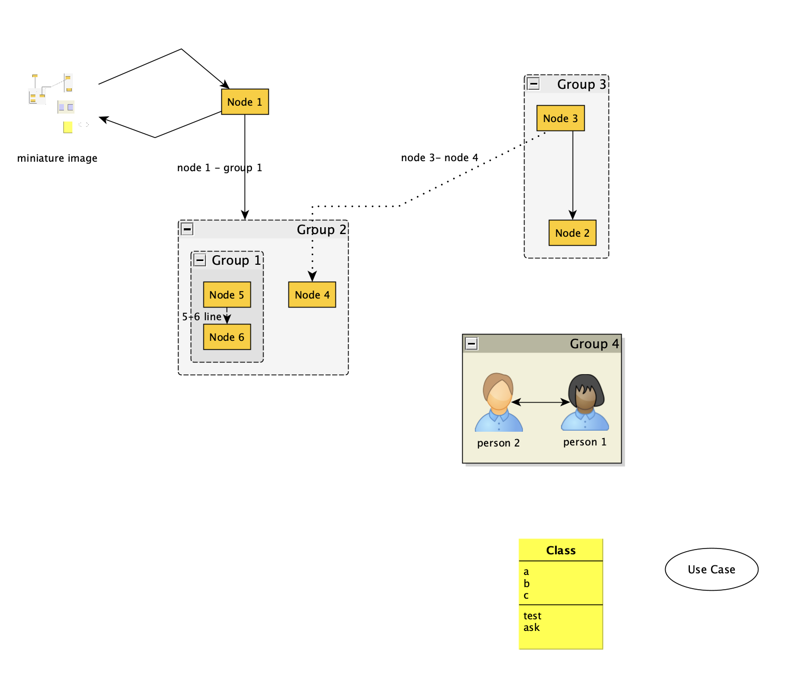
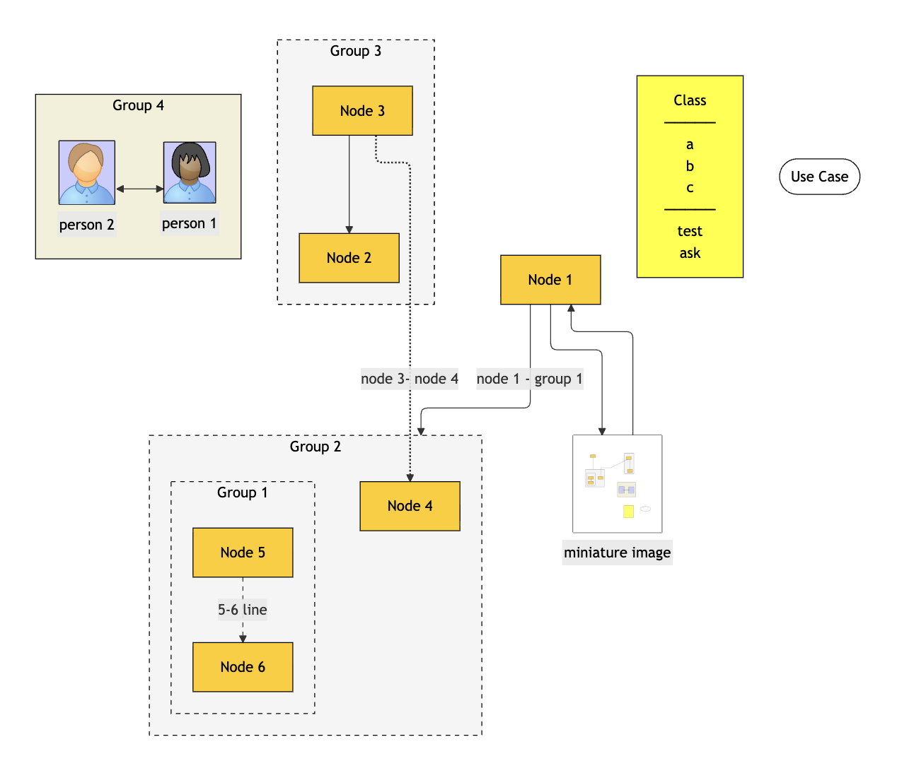

# yed2mermaid

Convert [yEd](https://www.yworks.com/products/yed) GraphML flowcharts into
[Mermaid](https://mermaid.js.org/) flowcharts.

One statically linked Zig binary, no runtime dependencies, no network access. It
reads a `.graphml` file you already own and prints (or writes) Mermaid text.

```console
$ yed2mermaid example/example.graphml -o example/example.mmd
```

Install with Homebrew, Chocolatey, or download an archive from the
[releases](https://github.com/d-led/yed2mermaid/releases):

```console
$ brew install d-led/d-led/yed2mermaid      # macOS and Linux
> choco install yed2mermaid                 # Windows
```

Release archives come with a `SHA256SUMS` file; the published `.rb` formula is
generated from it.

| What you draw in yEd | What comes out, rendered as Mermaid |
|---|---|
|  |  |

The command above turns [example/example.graphml](example/example.graphml) into
[example/example.mmd](example/example.mmd). To look at the result without a
Mermaid toolchain, open [example/index.html](example/index.html) in a browser —
the page carries the diagram inline and loads Mermaid from a CDN.
[example/images.html](example/images.html) is the same drawing converted with
`--images`, so the embedded pictures appear as pictures.

## What you get

* **Groups** become nested `subgraph` blocks; an arrow that ends on a group
  points at the subgraph, one that ends on a member node stays on it.
* **Shapes** follow the yEd palette or `y:Shape`, and **fills, borders and dash
  patterns** come along as `style` statements; edge labels, line styles and
  widths survive through `linkStyle`.
* **UML class members**, **embedded pictures** (`--images`) and the drawing's
  **flow direction** come across too.
* Whatever cannot be mapped faithfully is **marked and explained** — a comment,
  a warning and a purple box — never silently guessed.

What exactly survives, and what does not, is in
[docs/mapping.md](docs/mapping.md).

## Documentation

| Page | What is in it |
|---|---|
| [docs/cli.md](docs/cli.md) | every option, generated from `yed2mermaid --help` |
| [docs/usage.md](docs/usage.md) | configuration front-matter, pictures, the Mermaid traps |
| [docs/mapping.md](docs/mapping.md) | what the conversion preserves, and its limits |
| [docs/development.md](docs/development.md) | building, testing, the browsable examples |
| [docs/publishing.md](docs/publishing.md) | CI, releases, Homebrew and Chocolatey |
| [docs/legal.md](docs/legal.md) | yEd and yWorks licensing notes |

## Mermaid versions

The output is plain Mermaid, so what it needs depends on which features you use.

| Feature | Needs |
|---|---|
| the diagram itself — shapes, subgraphs, `linkStyle`, `click` | Mermaid 9.0 |
| the front-matter `config:` block | Mermaid 10.5 |
| `layout: elk` in that block | Mermaid 9.4, plus `@mermaid-js/layout-elk` in a browser |
| image nodes from `--images` | Mermaid 11.3 |

`--no-front-matter` is the escape hatch for renderers older than 10.5: the
diagram itself then works from 9.0 on. Verified against Mermaid 11.17, which is
what the render checks use.

## License

MPL-2.0, see [LICENSE](LICENSE).
